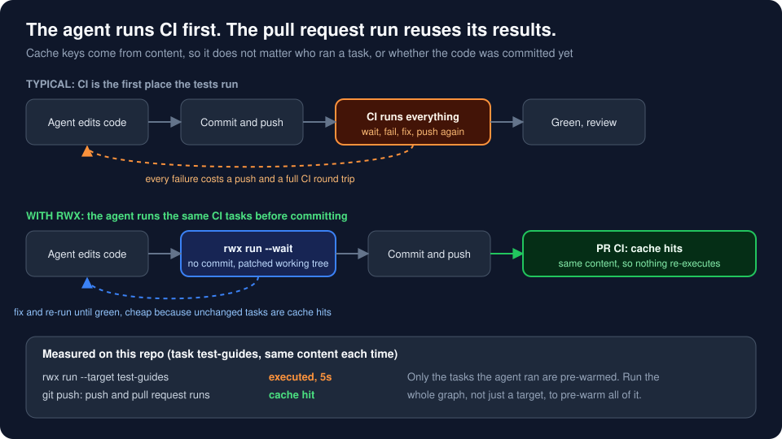
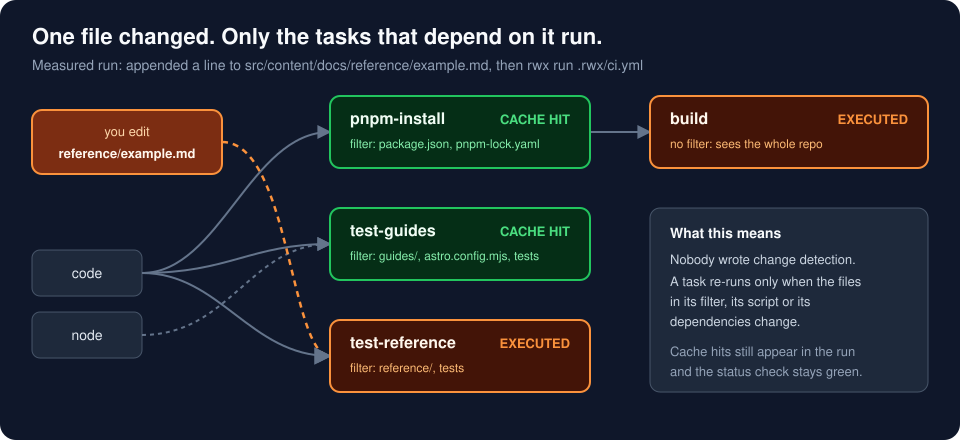
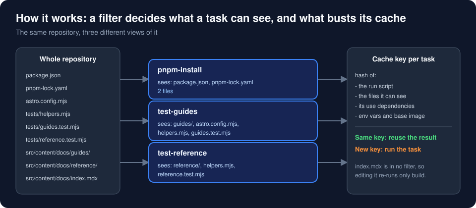
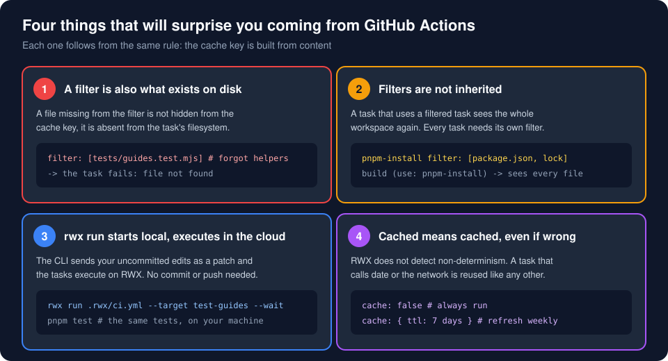

# rwx-app-playground

A small Astro + Starlight docs site used to demo [RWX](https://www.rwx.com) CI to engineers who already know GitHub Actions.

The site is not the point. The pipeline in [`.rwx/ci.yml`](.rwx/ci.yml) is, and in particular what it does for **coding agents**.

## The pitch

With AI agents writing code, CI becomes the slow part of the loop: the agent pushes, waits for CI, reads a failure, fixes, pushes again. RWX shortens that in three ways.

1. **The agent runs the real CI tasks before it commits.** `rwx run` sends the working tree, including uncommitted edits, so there is no "push to find out".
2. **Results are cached by content, not by who ran them.** When the agent's run passes and the same content is pushed, the pull request run finds the results already there and reuses them. CI re-runs nothing it has already seen.
3. **Only the affected tasks run.** A `filter` on each task lists the files it depends on, so a change to one docs section re-runs only that section's tests.



### What we measured

Two experiments on this repo. Same content in the agent's run and in the pushed runs.

**Full run, then push.** The agent ran the whole graph (`rwx run .rwx/ci.yml`), then committed and pushed.

| Run | Trigger | `pnpm-install` | `test-guides` | `test-reference` | `build` | Time |
|---|---|---|---|---|---|---|
| Agent | CLI, uncommitted | `cache_hit` | `cache_hit` | `cache_hit` | `executed` | 9s |
| Push | `github.push` | `cache_hit` | `cache_hit` | `cache_hit` | `cache_hit` | 3s |
| Pull request | `github.pull_request` | `cache_hit` | `cache_hit` | `cache_hit` | `cache_hit` | 1s |

The only task that executed was `build`, in the agent's run. Both CI runs reused every result. The other three were already cached from earlier runs of unchanged files.

**Targeted run, then push.** The agent ran only `--target test-guides` after a guide edit: `executed` in 5s. The push and pull request runs then showed `test-guides` as `cache_hit`, but `build` executed, because the agent had not run it. Only what the agent ran is pre-warmed.

## Coming from GitHub Actions

| | GitHub Actions | RWX |
|---|---|---|
| Unit of work | Job on a runner, with steps sharing one filesystem | Task in its own sandbox, joined by `use` |
| Order | `needs:` between jobs | `use:` between tasks, which also passes files and env vars |
| Caching | Opt in with `actions/cache` and keys you write | On by default, keyed by content |
| Running only affected tests | Path filters on triggers, or custom scripts | `filter:` per task, no scripting |
| Trying a change | Commit and push, then wait | `rwx run` sends your uncommitted edits |

## The graph: only dependent tasks run



## How this is possible: filters

A task's cache key is a hash of its `run` script, the files it can see, its `use` dependencies, its env vars and its base image. By default a task sees the whole repository, so any change anywhere changes the key.

A `filter` narrows that. It does two things at once: only the listed files go into the key, and only the listed files exist on disk for that task.



From [`.rwx/ci.yml`](.rwx/ci.yml):

```yaml
- key: test-guides
  use: [code, node]
  run: node --test tests/guides.test.mjs
  filter:
    - tests/helpers.mjs
    - tests/guides.test.mjs
    - astro.config.mjs
    - src/content/docs/guides
```

Edit anything under `src/content/docs/reference` and this task's key does not change, so RWX reuses the earlier result. The same mechanism is what lets an agent's run and the pull request run share results: the key depends on content, not on the commit or the trigger.

## Gotchas



The advice from the RWX docs: get a task passing with no filter first, then add the filter. If it then fails with a missing file, the filter is wrong, not the command.

## Running the agent loop

You need the RWX CLI signed in (`rwx whoami`). A prompt you can give an agent:

> Make sure CI passes with `rwx run .rwx/ci.yml --wait --fail-fast`, then commit and push.

With `--wait --fail-fast` the CLI stops at the first actionable failure and prints how to fetch logs and artifacts, so the agent can fix the problem and run again. To have the agent watch a run that is already pushed:

> Monitor CI with `rwx results --wait`. If anything fails, fix it and re-run `rwx run .rwx/ci.yml --wait`.

For an agent that needs its own environment, RWX also has [sandboxes](https://www.rwx.com/docs/sandboxes), which use the same task definitions. This repo does not configure one.

## Try it by hand

**1. Run everything.** The first run executes every task.

```sh
rwx run .rwx/ci.yml --wait --fail-fast
```

**2. Change one guide and run again.**

```sh
echo "A new line." >> src/content/docs/guides/example.md
rwx run .rwx/ci.yml --wait --fail-fast
```

**3. See which tasks executed and which were cache hits.** Use the run ID the CLI prints.

```sh
rwx results <run-id> --json | jq -r '
  .Tasks[] | recurse(.Subtasks[]?) | select(.TaskType == "command")
  | "\(.Key)\t\(.Status.FinishedSubStatus)"'
```

Expect `test-guides` and `build` to be `executed`, and `test-reference` and `pnpm-install` to be `cache_hit`. Repeat with a file under `reference/` and it flips.

**4. Run one task only.**

```sh
rwx run .rwx/ci.yml --target test-guides --wait --fail-fast
```

`--target` runs that task and its dependencies, nothing else.

**5. Commit and push, then compare.** Run `rwx runs list --branch <your-branch>` and check the pushed run's tasks with the `jq` command above. Anything the CLI run already did should be a `cache_hit`.

**6. The same tests on your own machine.**

```sh
pnpm test
```

## Release path: artifact on `main` only

`build` runs on every trigger. The `package` task publishes `dist` as the `site` artifact, but only when the `release` init parameter is true:

| Trigger | `release` |
|---|---|
| Push to `main` | `true` |
| Push to any other branch | `false` |
| Pull request | `false` |
| `rwx run` from the CLI | `false` |

You do not have to merge to test it:

```sh
rwx run .rwx/ci.yml --wait --init release=true
rwx artifacts list <run-id> --task package
```

## What is in this repo

| Path | Purpose |
|---|---|
| `.rwx/ci.yml` | The pipeline: `code`, `node`, `pnpm-install`, `test-guides`, `test-reference`, `build`, `package` |
| `tests/guides.test.mjs` | Checks for `src/content/docs/guides` |
| `tests/reference.test.mjs` | Checks for `src/content/docs/reference` |
| `tests/helpers.mjs` | Shared checks, parameterised by docs section |
| `src/content/docs/` | The Starlight content the tests look at |

The tests use only Node's built-in test runner and are deliberately small. They exist to give the graph something to cache.

## What this demo does not prove

Say these out loud when presenting.

- **The numbers are small.** This is a tiny site, so the seconds saved are small. The value is in how the behaviour scales to slow suites, not in the time saved here.
- **The agent-to-CI reuse was measured on one small pipeline.** It matches how content-based caching is documented to work, but a larger pipeline with real dependencies and services may behave differently.
- **Nothing pre-warms by itself.** Only what the agent ran is reused later. If it runs one `--target`, only that target is warm. If it never runs CI before pushing, CI runs everything.
- **`build` has no filter,** so it re-runs on every change. That is intentional: it depends on the whole site.
- **`rwx run` executes in the RWX cloud.** It starts from your machine without a commit, but it does not run locally. `pnpm test` is the local equivalent.

## Further reading

- [CI reference workflow](https://www.rwx.com/docs/guides/ci)
- [Agentic run loops](https://www.rwx.com/docs/agentic-run-loops)
- [Caching](https://www.rwx.com/docs/caching) and [filtering files](https://www.rwx.com/docs/filtering-files)
- [CLI triggers](https://www.rwx.com/docs/cli-triggers) and [artifacts](https://www.rwx.com/docs/artifacts)
